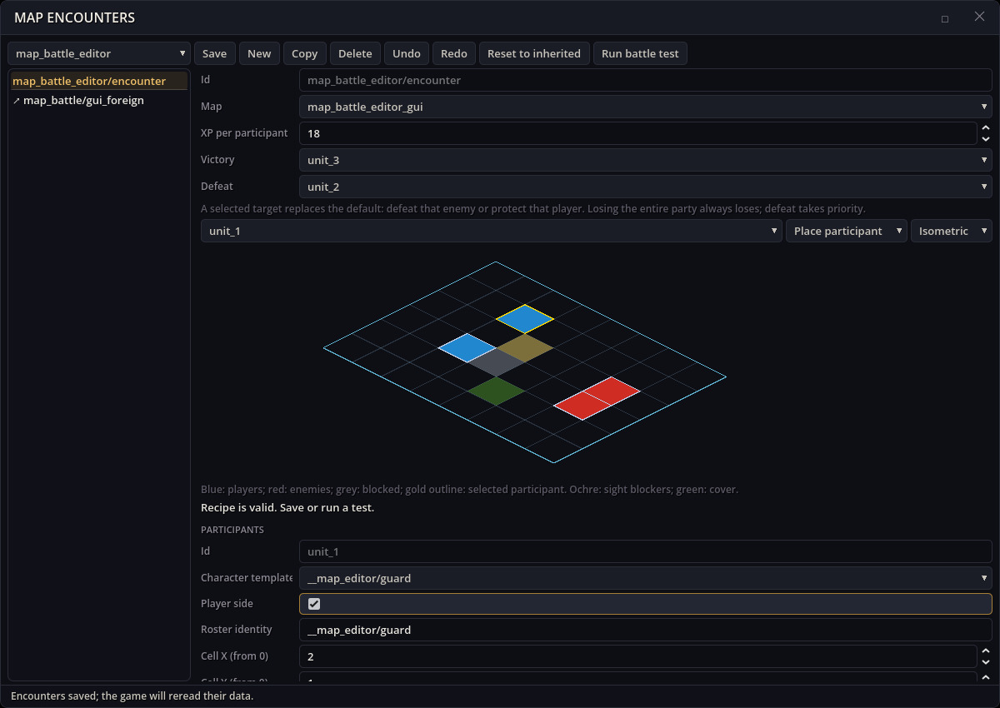
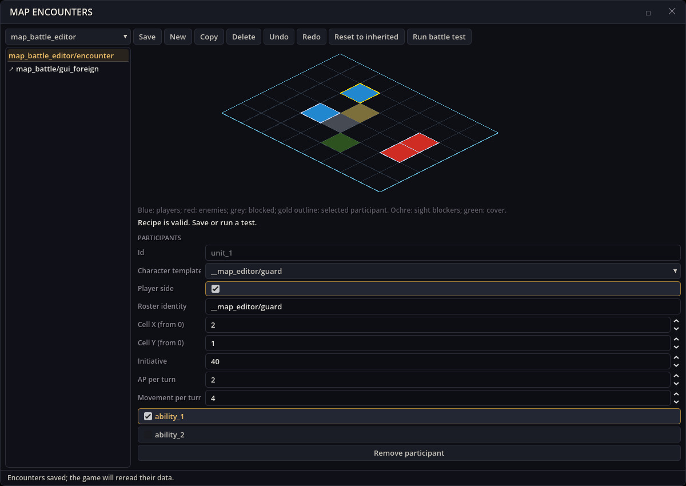
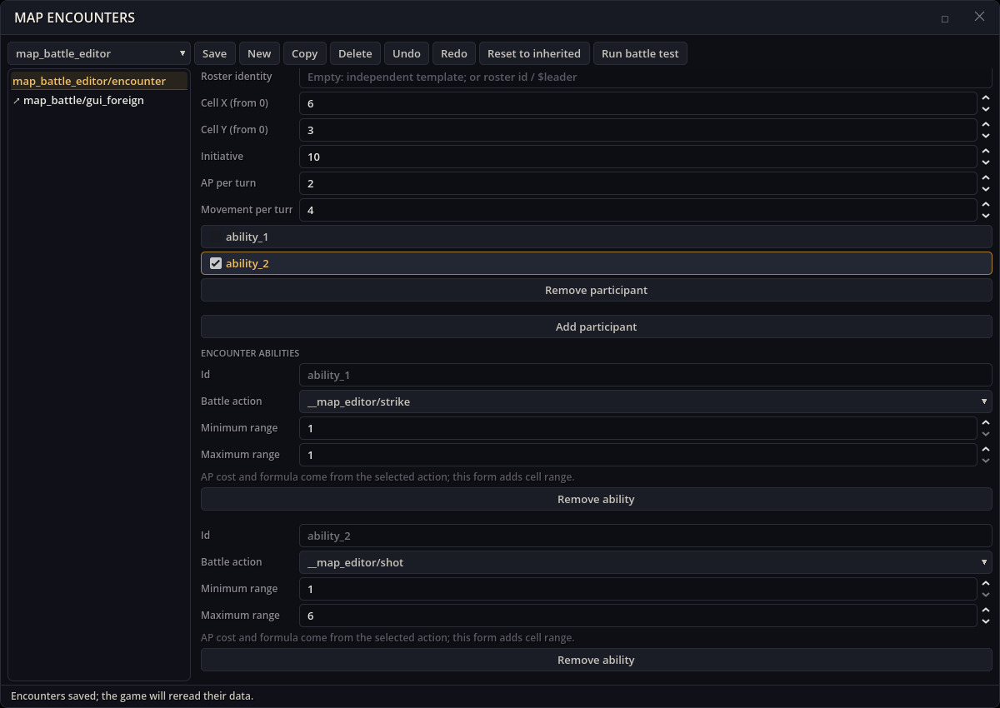
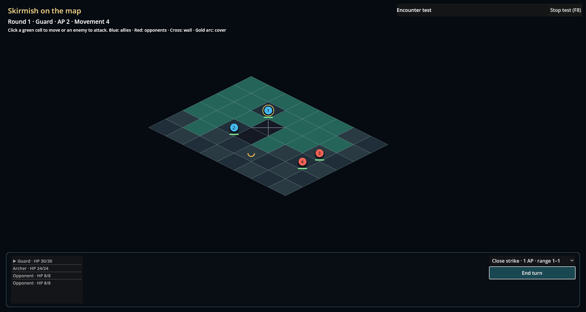

# Map encounter editor

`map_battle_editor` authors turn-based `map_battle` encounters for an ordinary 2D game. Choose the map, participants and sides, starting cells, abilities, reward and completion rules. Place cells and paint masks by clicking the actual map preview in top-down or isometric projection. Creating an encounter requires no JSON editing.

The window uses the shared `EntityDocument` model: New/Copy/Delete, undo/redo, changed-file saving and minimal inherited patches. It is an authoring tool; a game needs only `map_battle` to play saved encounters.

## Prepare your content

1. In **Mods & Collections**, choose your 2D game or a copy of RPG Plus. Use **New mod**, add `map_battle_editor`, save the collection and restart. It brings `map_battle`, common tools and the RPG map editor; the game supplies its installed renderers and content.
2. Create and save a map in the [RPG Map Editor](../../rpg_editor/docs/en.md). Verify ordinary collision by walking. Encounters support maps up to 128×128; the map also needs a registered logical scene for play testing.
3. Prepare templates through [Characters](../../characters_editor/docs/en.md) and actions through the [Data Editor](../../schema_tools/docs/en.md): `ToEnemy`, a damage formula and positive `RequiredPoint`. [Battle Formulas](../../battle_formulas/docs/en.md) describes the language. Assign the actions to the characters. Enable these additional tool mods separately if absent.

The slice accepts damage without pool costs, healing, statuses or piercing. Use real portraits/resources from your game. Do not copy another mod’s files merely to configure one encounter.

## Create a two-versus-two encounter

1. Open **Tools → Map encounters**. Choose your destination mod at the upper left and click **New**.
2. You may customize the proposed identity before its first save. Choose the **Map** and **XP per participant**. A saved identity is locked because scenarios and saves reference it; use **Copy** for a different encounter identity.
3. Under **Encounter abilities**, click **Add ability**. Select an existing action and its inclusive minimum/maximum cell range. Add a close ability with 1–1 and a ranged ability with 1–6 for this example. Local IDs such as `ability_1` are automatic; AP cost and formula come from the action.
4. Click **Add participant** four times. Choose each template and tick its available ability. Enable **Player side** for two fighters and leave two as opponents. Two enemies may use the same template without sharing health or occupancy.
5. Set initiative and per-turn budgets: for example initiative 40/30/20/10, 2 AP and 4 movement. Higher initiative acts first; ties use the local instance ID.
6. Select a participant above the preview, choose **Place participant** and click an open cell. Alternatively enter X/Y in its card, starting from zero. Living participants may not overlap or start on blocked ground.



This is a real practice map with two allies and two opponents. Blue marks players, red marks opponents, grey marks blocked ground and a gold outline identifies the selected participant. On a map with artwork, the preview uses the ordinary renderer and effective placed-object collision. It does not edit the map itself.

**Roster identity** is optional. Empty means an independent template copy with no party XP recipient. Enter `$leader` for the current leader or an existing member’s ID for a companion. That member’s actual action slots must authorize the selected actions. Joining the party is authored through the character editor/ordinary scenario commands; this field does not create a member. Linked participants use their effective stats and equipment.





## Sight blockers and cover

Walkability comes from the map. Choose **Sight blocker** to paint cells that should block attack sight. **Low cover** reduces ranged damage by 2 before shields. Another click toggles the selected mask; **Erase both masks** clears both kinds only at that cell.

Blocked ground does not automatically block sight. Grey geometry and the ochre sight mask represent different rules. Projection changes keep cells unchanged, stored as `y * Width + x`. If you resize the map in another editor, recheck spawn positions and masks.

## Victory, defeat and rewards

For **Victory**, select **All opponents defeated** or one enemy’s local ID. The latter wins when that enemy falls even if other enemies live. For **Defeat**, select **Entire party defeated** or a protected player participant. Losing that participant ends the encounter; losing the whole party always loses. Defeat takes priority when both conditions hold.

**Return to the map** settles victory and awards XP to each linked player. Zero XP does not make an encounter repeatable. Unlinked copies receive no party reward. Conditions are captured with the fight and restored from saves rather than reread from an edited recipe mid-turn.

## Save and connect it to your game

Click **Save**. Both sides, references, action assignments, bounds/occupancy, ranges and condition targets are checked before files are written. Invalid numeric input cannot silently save its previous valid value. Own encounters go to `encounters/<mod>.json`; inherited edits use `patches/map_battle/<mod>.json`. Required provider dependencies are added automatically. Unknown fields in your own encounter, participants and abilities are preserved.

**Copy** creates your own independent recipe; **Delete** asks for confirmation; **Undo/Redo** restore document operations. **Reset to inherited** removes a foreign recipe’s local patch while leaving its owner’s file unchanged.

In the [Scenario Editor](../../scenario_editor/docs/en.md), open the command palette, choose **Start a map encounter**, select the encounter in `id`, insert the command into a scenario for its map and save. The line is:

```scenario
action map_battle.start id=my_mod/encounter
end
```

The dialog and unfinished movement must release the world before combat starts. A first-entry scenario uses the ordinary scene header and one-shot execution. The [battle guide](../../map_battle/docs/en.md) explains controls, data and persistence.

## Test combat without changing the playthrough

From a running 2D map, click the upper **Run battle test** button. A valid unsaved draft may be tested; this does not replace **Save**. The tool captures game state, enters the chosen map without its ordinary entry scenarios and runs real `map_battle` combat. Finish any other battle/play test first; linked roster members must exist and be alive.



**Stop test / F8** restores the original map, health, AP, XP and reward ledger. Settling a terminal result also returns to the editor with the original playthrough restored. Document changes stay available for a separate save. Closing the tool during a trial releases it and restores state; no ordinary save slot is created.

## Common problems

- **Missing maps, characters or actions.** Enable their providers in the game and save their data through the appropriate editor. The encounter editor does not create those entities.
- **Save refused.** Read the preview hint and status. Use 1–2 players, 1–20 opponents, unique instances, legal cells and assigned abilities. Invalid cards remain editable/undoable.
- **Combat does not start.** Check the running 2D map, its scene, living roster and absence of another fight. Modal UI or unfinished movement may delay start.
- **No XP.** Check roster links, reward and one-shot identity. A test run deliberately rolls XP back.
- **Projection missing.** Install its renderer in the collection. Only available projections are offered.

The captured examples belong to a test fixture; installing the editor does not add them to your game. Live map/party edits, item rewards and arbitrary logical condition expressions are outside this slice. The form supports side elimination or a selected participant objective.
