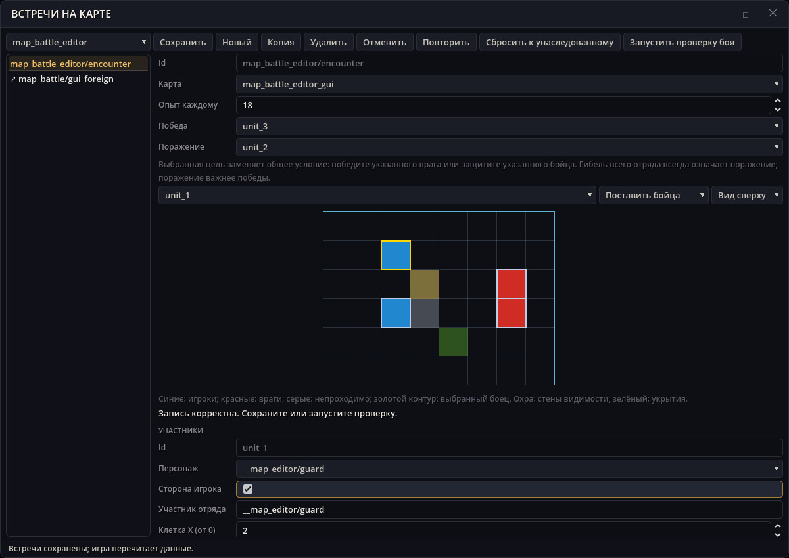
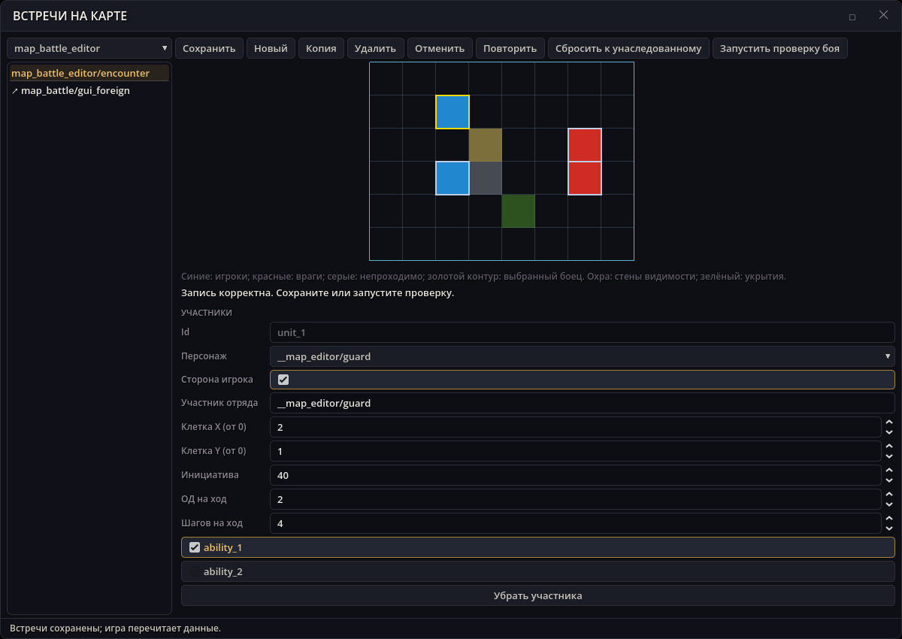
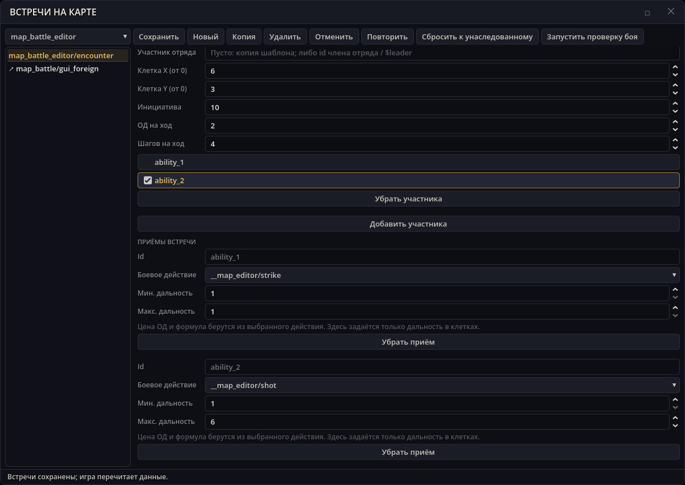
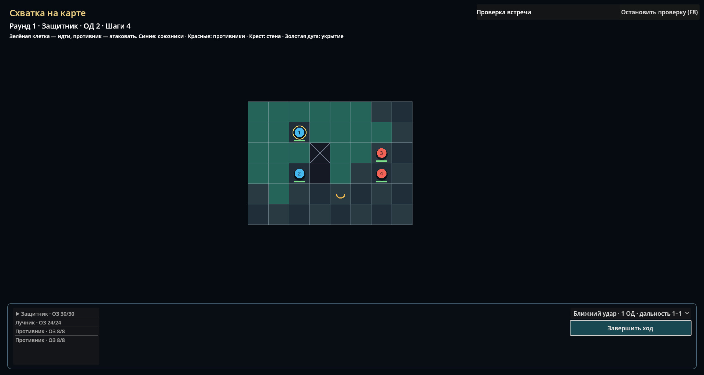

# Редактор встреч на карте

`map_battle_editor` создаёт пошаговые встречи для `map_battle` в обычной двумерной игре. В окне выбираются карта, бойцы и стороны, клетки появления, приёмы, награда и условия завершения. Клетки и маски можно задавать кликом по настоящему превью карты в виде сверху или изометрии. Для создания встречи JSON писать не требуется.

Редактор использует общую модель документов `EntityDocument`: новый/копия/удалить, отмена/повтор, сохранение изменённых файлов и минимальные патчи чужих записей. Это инструмент автора; для игры с уже сохранёнными встречами он не нужен.

## Подготовить содержимое

1. В **Модах и коллекциях** выберите свою 2D-игру или копию RPG Plus. Создайте свой мод через **Новый мод**, добавьте `map_battle_editor` и сохраните состав. После изменения состава перезапустите игру. Мод подтянет `map_battle`, общие инструменты и редактор RPG-карт; выбранные рендереры и содержимое поставляет игра.
2. Создайте и сохраните карту в [редакторе RPG-карт](../../rpg_editor/docs/ru.md). Проверьте коллизию обычной ходьбой. Встречи поддерживают карты до 128×128; у новой карты должна быть зарегистрирована логическая сцена для проверки боя.
3. Через [Персонажей](../../characters_editor/docs/ru.md) подготовьте шаблоны бойцов. Через [Редактор данных](../../schema_tools/docs/ru.md) подготовьте боевые действия: цель `ToEnemy`, формула урона, положительная цена `RequiredPoint`. [Боевые формулы](../../battle_formulas/docs/ru.md) объясняют язык. Назначьте действия персонажам. Эти дополнительные окна подключаются к коллекции отдельно, если их ещё нет.

Режим пока принимает урон без маны, лечения, состояний и пробивания. Выбирайте действия с реальными портретами/ресурсами вашей игры. Чужие файлы ради одной встречи копировать не нужно.

## Создать встречу 2 на 2

1. Откройте **Инструменты → Встречи на карте**. Слева сверху выберите свой мод назначения и нажмите **Новый**.
2. До первого сохранения можно изменить предложенный id. Выберите **Карту** и задайте **Опыт каждому**. После сохранения id блокируется: сценарии и сохранения ссылаются на него. Для другой личности встречи используйте **Копия**.
3. Ниже в **Приёмах встречи** нажмите **Добавить приём**. Выберите существующее боевое действие и минимальную/максимальную дальность. Для примера добавьте ближний приём 1–1 и дальний 1–6. Локальные id `ability_1`, `ability_2` создаются автоматически; формулу и цену ОД редактор берёт из действия.
4. Нажмите **Добавить участника** четыре раза. Для каждого выберите персонажа и назначьте нужный приём флажком. Двум бойцам включите **Сторона игрока**, двум оставьте её выключенной. Одного шаблона врага достаточно для двух независимых экземпляров.
5. Задайте инициативу и запасы на ход: например 40/30/20/10 по инициативе, 2 ОД и 4 шага. Чем больше инициатива, тем раньше ход; равные значения сравниваются по локальному id.
6. Выберите бойца над превью, режим **Поставить бойца** и нажмите свободную клетку. Либо задайте X/Y в его карточке: координаты начинаются с нуля. Живые участники не могут начинать в одной клетке или на непроходимой поверхности.



Это реальная учебная карта с двумя союзниками и двумя противниками. Синие клетки обозначают сторону игрока, красные — врагов; серые — непроходимость, золотой контур — выбранного бойца. На карте с настоящими объектами превью использует обычный рендерер и эффективную геометрию, включая размещённые объекты и коллизию. Саму карту окно не изменяет.

**Участник отряда** — необязательная связь с логическим персонажем. Пустое поле даёт независимую копию шаблона без выдачи опыта отряду. Для ведущего можно вписать `$leader`; для спутника — id существующего члена отряда. Его реальные слоты действий должны разрешать выбранные приёмы. Присоединение персонажа к отряду настраивается через редактор персонажей/обычные сценарные команды, а не создаётся этой привязкой. При связанной записи игра использует итоговые характеристики и экипировку персонажа.





## Стены видимости и укрытия

Проходимость берётся с карты. Для зрения есть отдельный режим **Стена видимости**: нажимайте клетки, которые должны блокировать линию атаки. **Низкое укрытие** отмечает клетки, уменьшающие дальний урон на 2 до поглощения щитом. Повторный клик снимает отметку этого вида; **Убрать обе отметки** очищает обе маски только в выбранной клетке.

Непроходимая клетка не становится непрозрачной автоматически. Серая геометрия и охристая маска зрения показывают разные правила. Проекция переключается без изменения клеток: номер клетки сохраняется как `y * Width + x`. Если изменить ширину карты в другом редакторе, проверьте размещение и маски заново.

## Победа, поражение и награда

В списке **Победа** выберите **Все противники побеждены** либо локальный id конкретного врага. Во втором случае его поражение завершает встречу, даже если другие враги живы. В **Поражении** выберите **Весь отряд побеждён** либо защищаемого бойца игрока. Гибель защищаемого завершает бой поражением; гибель всего отряда всегда означает поражение. Если условия выполнены вместе, поражение важнее.

Опыт начисляется каждому связанному игроку при расчёте победы через **Вернуться на карту**. Нулевая награда не делает встречу повторяемой. Строки без связи с отрядом опыт не получают. Сохранённые условия восстанавливаются вместе с боем, а не перечитываются из изменённой формы посреди хода.

## Сохранить и включить в игру

Нажмите **Сохранить**. Редактор проверяет обе стороны, ссылки, назначенные действия, координаты, занятость, дальности и цели условий до записи файлов. Ошибочное числовое поле нельзя сохранить как старое корректное значение. Данные своей встречи находятся в `encounters/<мод>.json`; изменения чужой — в обычном `patches/map_battle/<мод>.json`. Нужные зависимости на поставщиков добавляются автоматически. Неизвестные поля своей записи, бойцов и приёмов сохраняются.

**Копия** создаёт свою независимую запись, **Удалить** требует подтверждения, **Отменить/Повторить** возвращают операции документа. Для чужой записи **Сбросить к унаследованному** удаляет локальный патч; исходник владельца не меняется.

В [редакторе сценариев](../../scenario_editor/docs/ru.md) откройте палитру команд, выберите **Начать бой на карте**, затем свою встречу в поле `id`. Вставьте команду в сценарий нужной карты и сохраните. Она имеет вид:

```scenario
action map_battle.start id=my_mod/encounter
end
```

Перед началом диалог и движение должны закончиться. Для сценария первого входа используйте обычный заголовок сцены и одноразовое выполнение. [Руководство боя](../../map_battle/docs/ru.md) объясняет игровой ввод, формат и сохранения.

## Проверить бой без изменения прохождения

В запущенной 2D-карте нажмите верхнюю кнопку **Запустить проверку боя**. Можно проверить несохранённую корректную форму: это не заменяет **Сохранить**. Инструмент запоминает состояние игры, входит в сцену выбранной карты без обычных вступительных сценариев и запускает настоящий бой через `map_battle`. Другой активный бой или проверка должны сначала завершиться; связанные члены отряда должны существовать и быть живы.



**Остановить проверку / F8** возвращает исходную карту, здоровье, ОД, опыт и ведомость наград. Расчёт терминального результата тоже возвращает редактор с восстановленным прохождением. Изменения документа остаются для отдельного сохранения. Закрытие окна во время проверки освобождает её и восстанавливает состояние; обычное сохранение игры для этого не создаётся.

## Если что-то не получается

- **Пустой список карт/персонажей/действий.** Подключите поставщика к игре и сохраните его данные в соответствующем редакторе. Сам редактор встреч не создаёт эти сущности.
- **Запись не сохраняется.** Прочитайте подсказку под превью и статус: нужны 1–2 игрока и 1–20 врагов, уникальные экземпляры, допустимые клетки и назначенные приёмы. Неверная карточка остаётся в документе для исправления/отмены.
- **Бой не начинается.** Проверьте игровую 2D-карту, её сцену, состояние отряда и отсутствие другого боя. Модальное окно и незавершённое движение могут задержать начало.
- **Нет опыта.** Проверьте связь с отрядом, величину награды и одноразовую личность встречи. В тестовом запуске опыт специально откатывается.
- **Нужной проекции нет.** Установите её рендерер в коллекцию. Окно предлагает только доступные проекции.

Настоящие примеры на кадрах принадлежат тестовой фикстуре; установка редактора не добавляет их в вашу игру. Смена состава/геометрии карты во время активного боя, предметные награды и произвольные логические выражения условий сюда не входят. Условия формы поддерживают устранение стороны или выбранного участника.
